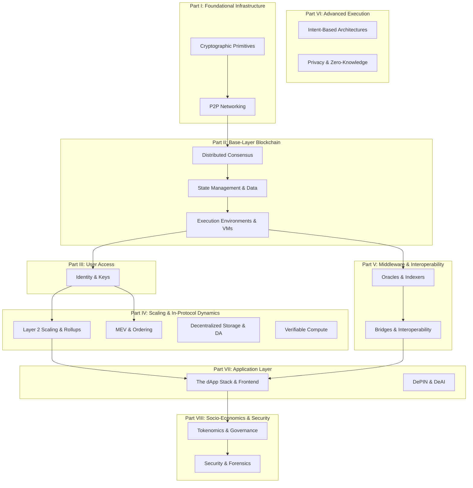
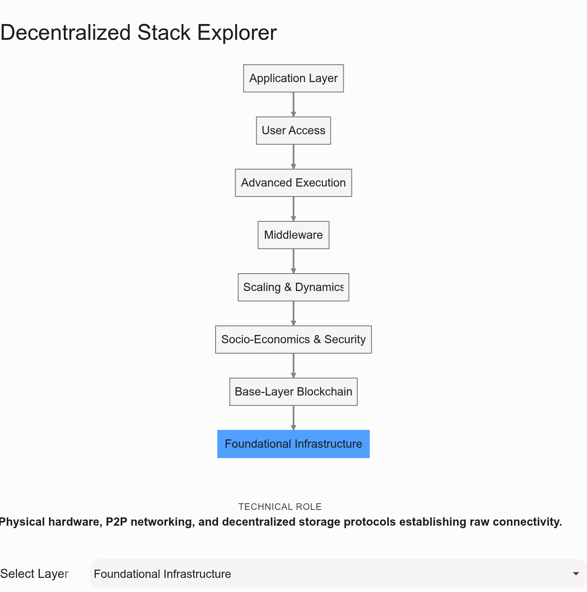

## The Evolution of Trust and Compute

For the past three decades, the internet has primarily operated on a client-server paradigm. You (the client) ask a centralized server for information, and the server decides whether to grant it, alter it, or deny it. Trust is delegated to a single entity, which fundamentally creates a single point of failure and control.

Decentralized technologies flip this model entirely. Instead of a single centralized server, a global, permissionless network of computers (nodes) works together to maintain a shared, objective reality,. To achieve this without a central coordinator, the ecosystem relies on a deeply interconnected "stack" of technologies.

Understanding this stack requires breaking it down from the foundational mathematics at the very bottom, all the way up to the user-facing applications and economic incentives at the top.

---

## The Decentralized Technology Stack

The 18 core topics we identified do not exist in a vacuum; they form a logical, bottom-up architecture. Lower layers provide objective truth and security, middle layers provide scale and connectivity, and upper layers provide utility and governance.

Below is the architectural map of this ecosystem.

## Deconstructing the Journey: From Math to Applications

If we treat this syllabus as a journey, we are following the life cycle of a single piece of data as it transforms from a mathematical formula into a global application.

### 1. The Roots (Parts I & II)

Everything begins with **Foundational Infrastructure**. We use **Cryptographic Primitives** (like elliptic curves and hash functions) to create unforgeable digital signatures and verifiable data structures. Because there is no central server, these cryptographic messages must be broadcast across **Peer-to-Peer (P2P) Networks** using routing and gossip protocols.

Once the network is communicating, it must agree on a shared reality. This introduces the **Base-Layer Blockchain**. Nodes use **Distributed Consensus** (like Proof of Stake) to agree on the exact sequence of events. These events are written into a database (**State Management**) and executed by a **Virtual Machine** (like the EVM), turning the network from a simple ledger into a globally programmable computer.

### 2. The Bridge (Parts III & IV)

With the global computer running, we need a secure way to interact with it. **User Access** involves translating human intent into cryptographic signatures via Wallets, Seed Phrases, and Decentralized Identity primitives.

However, a single global computer gets congested quickly. **Scaling & Dynamics** addresses this bottleneck. We move heavy computation off the main chain using **Layer 2 Rollups** and **Verifiable Off-Chain Compute (ZK Coprocessors)**, anchoring only the final cryptographic proof to the base layer. We also tackle the complex game theory of how transactions are ordered in the mempool (**MEV**) and where massive data files are permanently hosted (**Decentralized Storage**).

### 3. The Connectors (Parts V & VI)

Blockchains are fundamentally blind to the outside world—they only know what is written in their own state. **Middleware & Interoperability** solves this isolation. **Oracles** securely feed external real-world data (like asset prices or weather) into the network, while **Bridges** allow completely isolated blockchains to pass messages and tokens to one another.

Simultaneously, **Advanced Execution** paradigms are emerging. **Zero-Knowledge Technologies** allow users to prove statements (e.g., "I have enough funds") without revealing the underlying sensitive data. **Intent-Based Architectures** shift the user experience from imperatively declaring *how* a transaction should execute to declaratively stating *what* outcome they want, letting decentralized solvers figure out the optimal routing.

### 4. The Frontier (Parts VII & VIII)

Finally, we reach the surface. The **Application Layer** is where developers build **dApps**, connecting standard web frontends to smart contracts. This layer is expanding rapidly beyond pure finance into **DePIN** (Decentralized Physical Infrastructure Networks, like distributed GPU rendering) and **DeAI** (decentralized artificial intelligence).

To sustain these ecosystems, we rely on **Socio-Economics & Security**. **Tokenomics and Governance (DAOs)** provide the incentive structures that keep participants honest and fund continuous open-source development. Because this code controls real value, **Security & Forensics** acts as the final shield, constantly hunting for smart contract vulnerabilities, auditing execution logic, and tracing malicious actors.